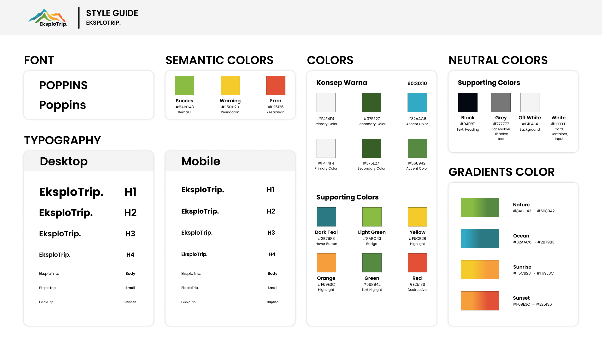
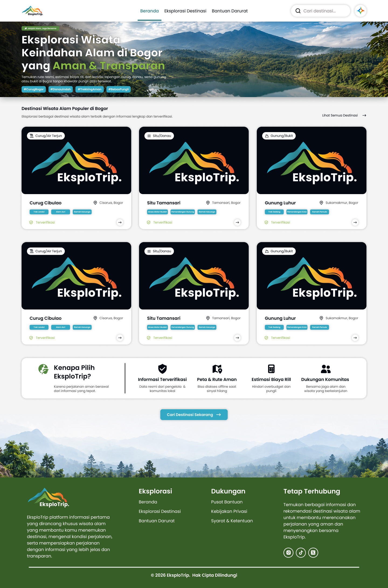
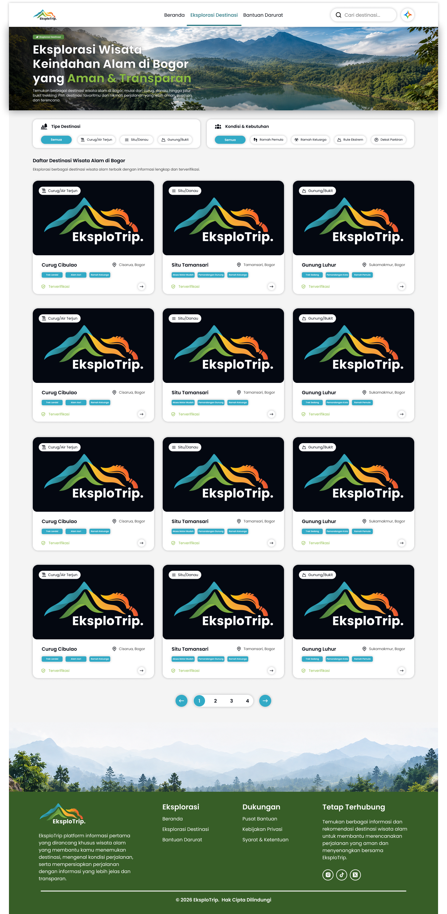
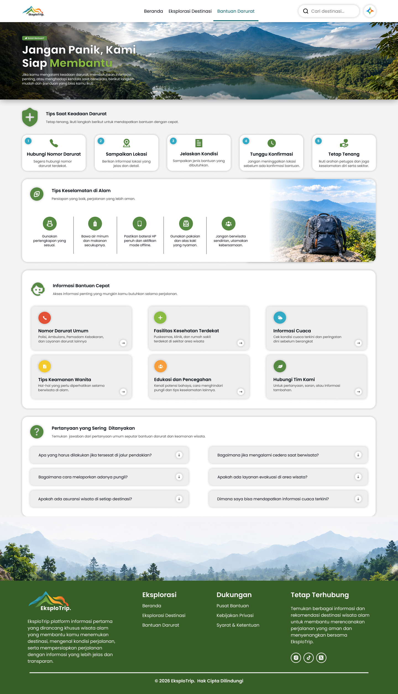
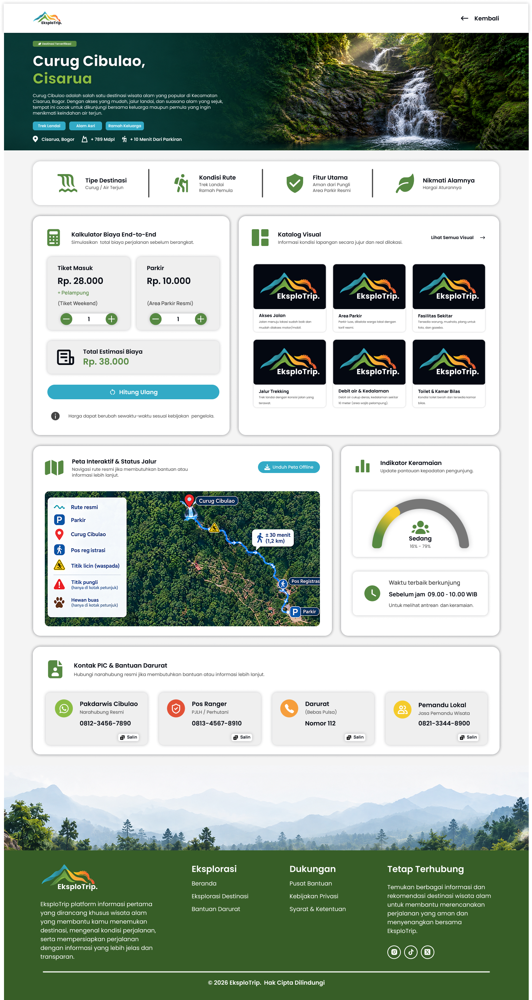
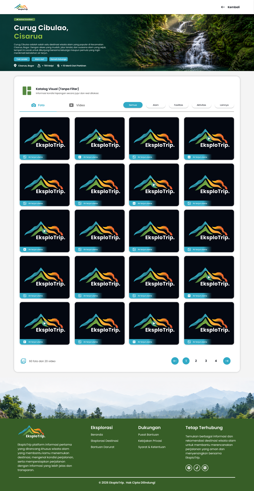
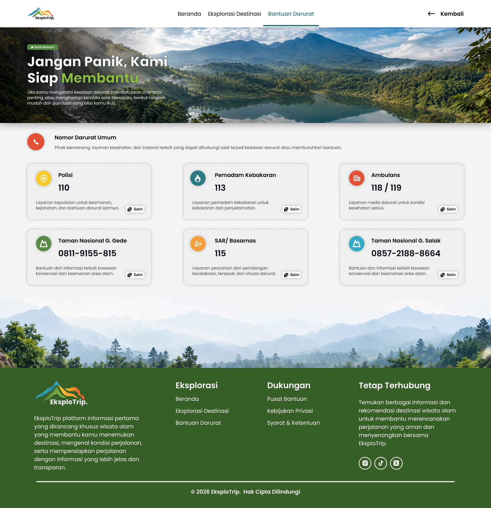
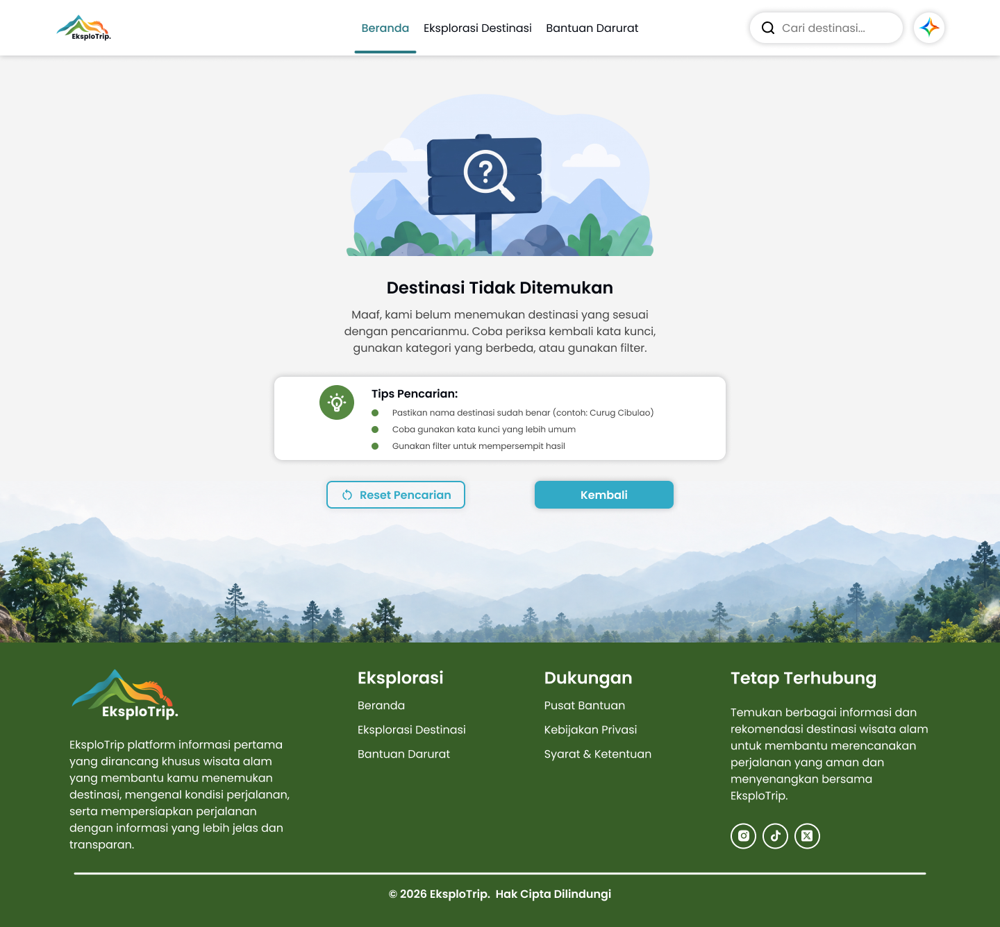
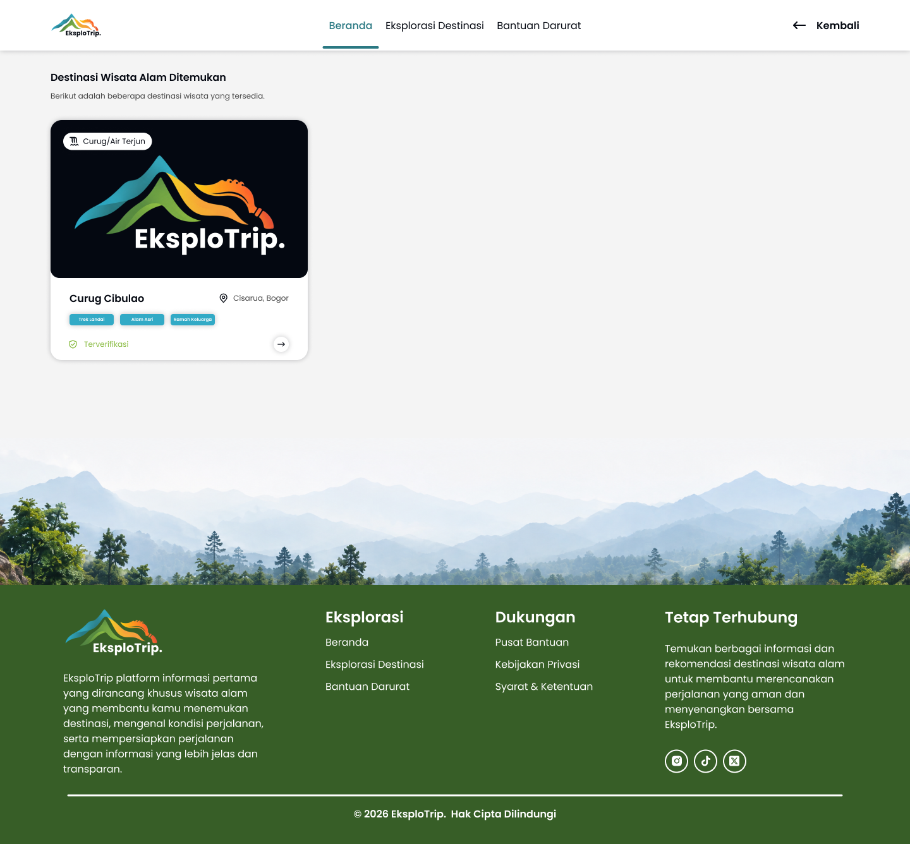

# EksploTrip - Design System & UI Specifications

## 1. Global Design System & Token Guide

### A. Color System & Gradients (CSS Variables)
*   **`--color-succes`**: `#8ABC43` (Aksen hijau terang, status terverifikasi & highlight judul)
*   **`--color-bg`**: `#F4F4F4` (Warna dasar canvas halaman)
*   **`--color-text-highlight`**: `#568942` (Warna hijau tua untuk aksen)
*   **`--color-footer`**: `#375E27` (Warna hijau latar belakang footer)
*   **`--color-button`**: `#32AAC6` (Warna biru primer untuk tombol, tag, dan elemen aktif)
*   **`--color-button-hover`**: `#2B7983` (State hover tombol biru)
*   **`--color-text`**: `#040811` (Warna hitam utama teks & icon)
*   **`--color-card`**: `#FFFFFF` (Warna putih latar kartu, navbar, & input)
*   **`--color-text-white`**: `#FFFFFF` (Warna teks putih)
*   **`--color-placeholder`**: `#888080` (Warna teks placeholder input pencarian)
*   **`--color-hover-text`**: `#444444` (Warna abu-abu gelap untuk subtitle, deskripsi sekunder, & garis pembatas)
*   **`--color-placeholder-card`**: `#EFEFEF` (Warna hover tombol filter default)
*   **Warna Status Tambahan (Token):**
    *   **Warning:** `#F5CB2B`
    *   **Error:** `#E25136`
    *   **Highlight:** `#F69E3C`
*   **Gradients (Token):**
    *   **Nature:** `#8ABC43` → `#568942`
    *   **Ocean:** `#32AAC6` → `#287983`
    *   **Sunrise:** `#F5CB2B` → `#F69E3C`
    *   **Sunset:** `#F69E3C` → `#E25136`

### B. Typography & Font Family
*   **Font Utama:** `'Poppins', -apple-system, BlinkMacSystemFont, 'Segoe UI', Roboto, sans-serif`
*   **Font Library Icon:**
    *   **Google Material Symbols Outlined** (`opsz 20..48`, `wght 400..600`, `FILL 0..1`, `GRAD -50..200`)
    *   **Font Awesome 6 Brands CDN** (`https://cdnjs.cloudflare.com/ajax/libs/font-awesome/6.5.1/css/all.min.css`) untuk logo media sosial resmi (Instagram, TikTok, X).

### C. Box Shadows & Dimensi Global
*   **`--card-shadow`**: `0px 0px 10px rgba(4, 8, 17, 0.25)` (Digunakan pada kartu filter, kartu destinasi, kartu keunggulan, & tombol AI)
*   **`--input-shadow`**: `0px 0px 10px rgba(4, 8, 17, 0.25)` (Digunakan pada search bar navbar)
*   **`--pill-shadow`**: `0px 0px 6px rgba(4, 8, 17, 0.22)` (Digunakan pada tombol filter & tombol panah kartu)
*   **`--button-shadow`**: `0px 4px 12px rgba(50, 170, 198, 0.35)` (Digunakan pada tombol CTA utama)
*   **`--artboard-width`**: `1440px` (Lebar maksimal canvas / container konten)
*   **`--screen-padding`**: `50px` (Padding horizontal kanan & kiri layout desktop, konten aktif: `X = 50px` sampai `X = 1390px`, lebar area konten: `1340px`)

---

## 2. Page 1 - Beranda

### A. Navbar (`.navbar`)
*   **Dimensi & Layout:**
    *   **Tinggi Navbar:** `80px`
    *   **Lebar Container (`.navbar-container`):** `100%`, `max-width: 1440px`, margin `0 auto`
    *   **Padding Horizontal:** `0 50px` (`var(--screen-padding)`)
    *   **Struktur Grid:** `3 Kolom (1fr auto 1fr)` dengan `align-items: center`
    *   **Background:** `var(--color-card) (#FFFFFF)`
    *   **Z-Index:** `100` (sticky/fixed context)
*   **Logo Brand (`.navbar-brand` / `.navbar-logo`):**
    *   **Source:** `assets/images/beranda/logo_eksplotrip_navbar.png`
    *   **Ukuran:** Lebar `81px`, Tinggi `40px`, `object-fit: contain`
    *   **Penataan:** Rata kiri (`justify-self: start`)
*   **Menu Navigasi (`.navbar-menu` / `.nav-links`):**
    *   **Penataan:** Posisi tengah presisi (`justify-self: center`)
    *   **Gap Antar Menu:** `36px`
    *   **Typography Link (`.nav-item a`):** Size `16px`, Line-height `24px`, Weight `500 (Medium)`, Color `var(--color-text) (#040811)`, Hover Color `var(--color-hover-text) (#444444)`
    *   **State Aktif (`.nav-item.active a`):** Color `var(--color-button) (#32AAC6)`
    *   **Indikator Aktif Menu (`.nav-indicator` / `.nav-item.active::after`):**
        *   Posisi: `absolute`, `bottom: 4px`, `left: 0`, tinggi `3.5px`, radius `99px`
        *   Background: `var(--color-button) (#32AAC6)`
        *   Perpindahan Garis Mulus: Garis indikator aktif meluncur mulus secara horizontal (`transition: transform 0.52s cubic-bezier(0.25, 1, 0.35, 1), width 0.52s cubic-bezier(0.25, 1, 0.35, 1)`) mengikuti perpindahan menu aktif secara sinkron dengan sliding track konten. Tidak ada animasi kursor hover yang mengganggu (garis hanya meluncur mulus saat navigasi halaman aktif berganti).
    *   **Transisi Perpindahan Halaman (Stationary Navbar & Sliding Track Canvas):**
        *   **Navbar Diam & Sticky:** Navbar tetap berada di posisi atas secara statis (`position: sticky; top: 0; z-index: 100;`) tanpa reload, flicker, atau unmount saat perpindahan menu ("navbarnya diam").
        *   **Sliding Konten Penuh Bawah Navbar (`.page-slider-track`):** Seluruh konten di bawah navbar dibungkus dalam slider track horizontal (`width: 200%`, flex). Saat beralih antara Beranda dan Eksplorasi Destinasi, track meluncur mulus secara horizontal (`translateX(0%)` ↔ `translateX(-50%)`) dengan animasi kurva halus `cubic-bezier(0.25, 1, 0.35, 1)`.
        *   **Bebas Bug Saat Refresh ("di refrase"):** Halaman Beranda (`beranda.html`) dan Eksplorasi (`eksplorasi_destinasi.html`) memiliki state awal CSS langsung (`translateX(0%)` atau `initial-eksplorasi` `translateX(-50%)`), sehingga saat halaman di-refresh (F5), tampilan langsung muncul di halaman tujuan secara instan tanpa glitch, tanpa jumping, dan tanpa animasi flicker.
*   **Action Controls (`.navbar-actions`):**
    *   **Penataan:** Rata kanan (`justify-self: end`), Gap `16px`, `display: flex; align-items: center;`
    *   **Form Pencarian (`.search-form` / `.search-input`):**
        *   Dimensi Input: Lebar `220px`, Tinggi `44px`, Border-radius `99px`
        *   Padding: `0 16px 0 44px`
        *   Typography: Size `16px`, Color `var(--color-text)`
        *   Placeholder: `"Cari destinasi..."`, Color `var(--color-placeholder) (#888080)`
        *   Background: `var(--color-card) (#FFFFFF)`, Box-shadow `var(--input-shadow)`
        *   Icon Search: Google Material Symbols `search`, Size `18px`, Posisi `left: 16px`, Color `#040811`
    *   **Tombol AI Assistant (`.ai-button` / `.ai-logo`):**
        *   Dimensi Button: `44px x 44px`, Border-radius `99px` (lingkaran)
        *   Background: `var(--color-card) (#FFFFFF)`, Box-shadow `var(--card-shadow)`
        *   Gambar Icon AI: `assets/images/beranda/logo_aiplo.png`, Ukuran `34px x 34px`, `object-fit: contain`
        *   Hover Effect: `transform: scale(1.05); box-shadow: 0px 0px 14px rgba(4, 8, 17, 0.35);`

---

### B. Hero Banner (`.hero-section`)
*   **Container Utama:**
    *   **Lebar Banner:** `100%` (Full width)
    *   **Tinggi Banner:** `280px`
    *   **Background Image (`.hero-banner-img`):** `assets/images/beranda/banner_atas.png` (`object-fit: cover; object-position: center;`)
    *   **Overlay Gelap (`.hero-overlay`):** `linear-gradient(180deg, rgba(4, 8, 17, 0.45) 0%, rgba(4, 8, 17, 0.3) 100%)`
*   **Area Konten (`.hero-content`):**
    *   **Lebar:** `100%`, `max-width: 1440px`, `margin: 0 auto`
    *   **Padding Horizontal:** `0 50px` (`var(--screen-padding)`)
    *   **Tata Letak:** `display: flex; flex-direction: column; justify-content: center; align-items: flex-start;`
*   **Badge Slogan (`.hero-badge`):**
    *   **Teks:** `"Jelajahi Alam, Jaga Bersama"`
    *   **Icon:** Google Material Symbols `eco` (Font-size `11px`, Color `#FFFFFF`)
    *   **Typography:** Size `11px`, Line-height `15px`, Weight `500 (Medium)`, Color `#FFFFFF`
    *   **Dimensi Box:** Padding `4px 12px`, Border-radius `99px`, Margin-bottom `8px`
    *   **Background:** `rgba(4, 8, 17, 0.45)`, `backdrop-filter: blur(4px)`
*   **Judul Utama (`.hero-title`):**
    *   **Teks:** `"Eksplorasi Wisata Keindahan Alam di Bogor yang Aman & Transparan"`
    *   **Typography:** Size `40px`, Line-height `48px`, Weight `Bold (700)`, Color `#FFFFFF`, Letter-spacing `-0.2px`, Max-width `600px`
    *   **Stroke Teks:** `-webkit-text-stroke: 0.5px #000000;`
    *   **Highlight Teks (`strong`):** `"Aman & Transparan"`, Color `var(--color-succes) (#8ABC43)`, `-webkit-text-stroke: 0.5px #000000;`
*   **Deskripsi Hero (`.hero-desc`):**
    *   **Teks:** *"Temukan rute resmi, estimasi biaya riil, dan kondisi lapangan curug, danau, serta gunung atau bukit di Bogor tanpa khawatir pungli atau tersesat."*
    *   **Typography:** Size `13.5px`, Line-height `19px`, Weight `Regular (400)`, Color `#FFFFFF`, Max-width `550px`, Margin-top `5px`
*   **Tagar Destinasi (`.hero-tags`):**
    *   **Daftar Tagar:** `#CurugBogor`, `#DanauIndah`, `#TrekkingAman`, `#BebasPungli`
    *   **Layout:** `display: flex; align-items: center; gap: 8px; margin-top: 12px;`
    *   **Pill Tag (`li`):** Tinggi `23px`, Padding `0 10px`, Border-radius `6px`, Background `var(--color-button) (#32AAC6)`, Color `#FFFFFF`, Typography Size `11px`, Line-height `15px`, Weight `500 (Medium)`

---

### C. Filter Destinasi (`.filter-section`)
*   **Container Section:**
    *   **Lebar:** `100%`, `max-width: 1440px`, Margin `30px auto 0`, Padding `0 50px`
    *   **Layout Grid Kartu (`.filter-container`):** `display: flex; gap: 22px; width: 100%; align-items: stretch;`
*   **Kartu Filter (`.filter-card`):**
    *   **Dimensi:** Tinggi `96px`, Padding `14px 24px`, Border-radius `16px`
    *   **Background:** `var(--color-card) (#FFFFFF)`, Box-shadow `var(--card-shadow)`
    *   **Proporsi Lebar:**
        *   Kartu 1 ("Tipe Destinasi"): `flex: 445 1 0%;`
        *   Kartu 2 ("Kondisi & Kebutuhan"): `flex: 555 1 0%;`
    *   **Judul Filter (`.filter-title`):**
        *   Typography: Size `16px`, Line-height `24px`, Weight `600 (SemiBold)`, Color `#040811`
        *   Icon Judul: Material Symbols `landscape` (Tipe Destinasi) & `groups` (Kondisi), Size `20px`, Gap `10px`
*   **Tombol Filter (`.filter-buttons` / `.filter-btn`):**
    *   **Layout:** `display: flex; align-items: center; gap: 10px; flex-wrap: nowrap; width: 100%;`
    *   **Spesifikasi Tombol Default:**
        *   Tinggi: `27px`, Padding `0 10px`, Border-radius `99px`, `flex: 1 1 auto`
        *   Typography: Size `11.5px`, Line-height `16px`, Weight `500 (Medium)`, White-space `nowrap`
        *   Background: `var(--color-card) (#FFFFFF)`, Color `#040811`, Box-shadow `var(--pill-shadow)`
        *   Hover: `background-color: var(--color-placeholder-card) (#EFEFEF)`
        *   Icon Tombol: Material Symbols, Size `14px`, Gap `6px`
    *   **Daftar Icon & Tombol Tipe Destinasi:**
        *   `Semua` (Tanpa icon)
        *   `Curug/Air Terjun` (Icon: `water_drop`)
        *   `Situ/Danau` (Icon: `waves`)
        *   `Gunung/Bukit` (Icon: `landscape`)
    *   **Daftar Icon & Tombol Kondisi & Kebutuhan:**
        *   `Semua` (Tanpa icon)
        *   `Ramah Pemula` (Icon: `footprint`)
        *   `Ramah Keluarga` (Icon: `family_restroom`)
        *   `Rute Ekstrem` (Icon: `landscape`)
        *   `Dekat Parkiran` (Icon: `local_parking`)
    *   **Spesifikasi Tombol Aktif (`.filter-btn.active`):**
        *   Lebar Fleksibel: `flex: 1.1 1 auto`, Min-width `82px`
        *   Background: `var(--color-button) (#32AAC6)`, Color `#FFFFFF`
        *   Hover: `background-color: var(--color-button-hover) (#2B7983)`

---

### D. Destinasi Wisata Populer (`.destinations-section`)
*   **Header Section (`.destinations-header`):**
    *   **Dimensi:** Margin `32px auto 0`, Padding `0 50px`, Margin-bottom `30px`
    *   **Layout:** `display: flex; justify-content: space-between; align-items: flex-end;`
    *   **Judul (`.destinations-title`):** `"Destinasi Wisata Alam Populer di Bogor"`, Size `16px`, Line-height `24px`, Weight `700 (Bold)`, Color `#040811`
    *   **Subjudul (`.destinations-subtitle`):** `"Eksplorasi berbagai destinasi wisata alam terbaik dengan informasi lengkap dan terverifikasi."`, Size `12px`, Line-height `18px`, Color `var(--color-hover-text) (#444444)`, Margin-top `6px`
    *   **Link Semua Destinasi (`.destinations-view-all`):** `"Lihat Semua Destinasi"`, Size `12px`, Line-height `18px`, Weight `500 (Medium)`, Color `#040811`, Icon Material Symbols `arrow_forward` (`16px`, Gap `10px`), Hover: Color `var(--color-button)`, `transform: translateX(4px)`
*   **Grid Kartu Destinasi (`.cards-grid`):**
    *   **Layout:** `display: grid; grid-template-columns: repeat(3, minmax(0, 1fr)); column-gap: 31px; row-gap: 48px;`
*   **Struktur Kartu (`.destination-card`):**
    *   **Dimensi Kartu:** Tinggi `380px`, Border-radius `18px`, Overflow `hidden`
    *   **Background:** `var(--color-card) (#FFFFFF)`, Box-shadow `var(--card-shadow)`
    *   **Hover Animation:** `transform: translateY(-4px); box-shadow: 0 8px 24px rgba(4, 8, 17, 0.2);`
    *   **Media Gambar (`.card-media` / `.card-img`):**
        *   Tinggi Gambar: `250px`, Lebar `100%`, Border-radius `18px`, `object-fit: cover`
        *   Asset Default: `assets/images/beranda/list_katalog.png`
        *   Badge Kategori (`.card-badge`): Posisi `top: 20px; left: 20px;`, Tinggi `27px`, Padding `0 12px`, Radius `99px`, Background `#FFFFFF`, Color `#040811`, Typography Size `12px`, Line-height `16px`, Weight `500`, Box-shadow `0 2px 6px rgba(0, 0, 0, 0.15)`, Icon `14px` (`water_drop`, `waves`, `landscape`)
    *   **Konten Kartu (`.card-body`):**
        *   Padding: `22px 30px 16px`, `display: flex; flex-direction: column; justify-content: space-between; flex: 1;`
        *   **Baris Judul & Lokasi (`.card-header-row`):**
            *   Nama Destinasi (`.card-title`): Size `16px`, Line-height `22px`, Weight `700 (Bold)`, Color `#040811`, Ellipsis aktif
            *   Lokasi (`.card-location`): Size `12px`, Line-height `18px`, Weight `400 (Regular)`, Color `#444444`, Icon Material Symbols `location_on` (`14px`, Gap `5px`)
        *   **Baris Tag Fasilitas (`.card-tags`):**
            *   Layout: `display: flex; align-items: center; gap: 8px; flex-wrap: nowrap;`
            *   Pill Tag (`li`): Tinggi `18px`, Padding `0 8px`, Border-radius `4px`, Background `var(--color-button) (#32AAC6)`, Color `#FFFFFF`, Typography Size `8px`, Line-height `12px`, Weight `500`
        *   **Baris Status & Aksi (`.card-footer-row`):**
            *   Status Verifikasi (`.card-verified`): `"Terverifikasi"`, Size `11.5px`, Line-height `16px`, Weight `500`, Color `var(--color-succes) (#8ABC43)`, Icon Material Symbols `verified` (`FILL 1`, `wght 500`, Size `15px`, Gap `6px`)
            *   Tombol Navigasi Detail (`.card-action-btn`): Ukuran `26px x 26px`, Border-radius `50%` (lingkaran), Background `#FFFFFF`, Box-shadow `var(--pill-shadow)`, Color `#040811`, Icon Material Symbols `arrow_forward` (`14px`), Hover: Background `var(--color-button) (#32AAC6)`, Color `#FFFFFF`, `transform: scale(1.08)`

---

### E. Value Proposition ("Kenapa Pilih EksploTrip?") (`.value-prop-section`)
*   **Container Section:**
    *   **Dimensi:** Lebar `100%`, `max-width: 1440px`, Margin `50px auto 0`, Padding `0 50px`
*   **Kartu Keunggulan (`.value-prop-card`):**
    *   **Dimensi:** Tinggi `150px`, Padding `20px 36px 20px 62px`, Border-radius `18px`
    *   **Background:** `var(--color-card) (#FFFFFF)`, Box-shadow `var(--card-shadow)`
    *   **Layout:** `display: flex; align-items: center;`
*   **Brand / Judul Sisi Kiri (`.value-prop-brand`):**
    *   **Dimensi Kolom:** `flex: 0 0 285px`, `display: flex; align-items: flex-start; gap: 22px;`
    *   **Emblem Icon (`.brand-emblem-icon` / `.earth-eco`):** Google Material Symbols `eco` (`FILL 1`, `wght 600`, `opsz 48`), Size `48px`, Color `var(--color-succes) (#8ABC43)` (Ikon daun ramah lingkungan yang tegas dan proporsional dengan judul)
    *   **Judul Utama (`.value-prop-title`):** `"Kenapa Pilih EksploTrip?"`, Size `20px`, Line-height `26px`, Weight `700 (Bold)`, Color `#040811`
    *   **Subjudul (`.value-prop-desc`):** `"Karena perjalanan aman berawal dari informasi yang tepat."`, Size `10.5px`, Line-height `14.5px`, Weight `400 (Regular)`, Color `#444444`, Max-width `198px`, Margin-top `8px`
*   **Garis Pemisah Vertikal (`.value-prop-divider`):**
    *   **Dimensi:** Lebar `2px`, Tinggi `112px`, Radius `2px`
    *   **Margin:** `0 24px 0 36px`
    *   **Background:** `var(--color-hover-text) (#444444)`
*   **Fitur Keunggulan (`.value-prop-features` / `.feature-item`):**
    *   **Layout:** `display: flex; align-items: flex-start; justify-content: space-between; gap: 16px; flex: 1;`
    *   **Item Fitur (4 Poin Sejajar Rata):**
        *   Struktur Item: Rata tengah (`align-items: center; text-align: center; flex: 1;`)
        *   Container Icon (`.feature-icon`): Ukuran `28px x 28px`, Margin-bottom `10px`, Color `#040811`
        *   Icon Material Symbols: Size `28px`, Color `#040811`
        *   Judul Fitur (`.feature-title`): Size `13.5px`, Line-height `18px`, Weight `700 (Bold)`, Color `#040811`, Margin-bottom `4px`, White-space `nowrap`
        *   Deskripsi Fitur (`.feature-desc`): Size `10.5px`, Line-height `14.5px`, Weight `400 (Regular)`, Color `#444444`, Max-width `178px`
    *   **Spesifikasi 4 Poin Fitur:**
        1.  **Informasi Terverifikasi:** Icon `verified_user`, Deskripsi: *"Data resmi dari pengelola & komunitas lokal"*
        2.  **Peta & Rute Aman:** Icon `map`, Deskripsi: *"Bisa diakses offline saat sinyal hilang"*
        3.  **Estimasi Biaya Riil:** Icon `calculate`, Deskripsi: *"Hindari overbudget dan pungli"*
        4.  **Dukungan Komunitas:** Icon `groups`, Deskripsi: *"Bersama jaga alam dan wisata yang berkelanjutan"*

---

### F. Call to Action (CTA) & Banner Bawah (`.cta-section`)
*   **Container Section:**
    *   **Layout:** `display: flex; flex-direction: column; align-items: center; width: 100%; margin-top: 50px; position: relative;`
*   **Tombol CTA Mengambang (`.cta-btn-wrapper` / `.cta-btn`):**
    *   **Posisi:** Mengambang di atas banner (`margin-bottom: -20px; position: relative; z-index: 2;`)
    *   **Teks Tombol:** `"Cari Destinasi Sekarang"`
    *   **Icon:** Material Symbols `arrow_forward` (Size `16px`, Gap `10px`)
    *   **Dimensi:** Min-width `250px`, Tinggi `40px`, Padding `0 24px`, Border-radius `8px`
    *   **Typography:** Size `12px`, Line-height `18px`, Weight `600 (SemiBold)`, Color `#FFFFFF`
    *   **Background:** `var(--color-button) (#32AAC6)`, Box-shadow `var(--button-shadow)` (`0px 4px 12px rgba(50, 170, 198, 0.35)`)
    *   **Hover Animation:** `background-color: var(--color-button-hover) (#2B7983); transform: translateY(-2px); box-shadow: 0 6px 16px rgba(43, 121, 131, 0.4);`
*   **Banner Gambar Bawah (`.cta-banner-wrapper` / `.cta-banner-img`):**
    *   **Source:** `assets/images/beranda/banner_bawah.png`
    *   **Dimensi:** Lebar `100%`, Tinggi `233px`, `object-fit: cover; object-position: center top;`
    *   **Penempatan:** `position: relative; z-index: 1;`

---

### G. Footer (`.site-footer`)
*   **Container Utama:**
    *   **Lebar Canvas:** `100%`, Background `var(--color-footer) (#375E27)`, Color `#FFFFFF`
    *   **Container Konten (`.footer-container`):** `max-width: 1440px`, Margin `0 auto`, Padding `36px 50px 24px`
    *   **Tinggi Total Footer:** `~374px` (Padat, proporsional, dan bebas ruang kosong berlebih)
    *   **Tata Letak Atas (`.footer-top`):** `display: flex; justify-content: space-between; align-items: flex-start; gap: 32px;`
*   **Kolom 1: Profil & Brand (`.footer-col-brand`):**
    *   **Dimensi:** `flex: 0 0 330px; max-width: 330px;`
    *   **Logo Footer (`.footer-logo`):** `assets/images/eksplorasi_destinasi/logo_eksplotrip_footer.png`, Lebar `130px`, Tinggi auto, `object-fit: contain`, Margin-bottom `12px`
    *   **Deskripsi Platform (`.footer-brand-desc`):** Size `11.5px`, Line-height `17px`, Weight `400 (Regular)`, Color `#FFFFFF`
*   **Kolom 2: Navigasi Eksplorasi (`.footer-col-links`):**
    *   **Judul Kolom (`.footer-col-title`):** `"Eksplorasi"`, Size `16px`, Line-height `24px`, Weight `700 (Bold)`, Color `#FFFFFF`, Margin-bottom `12px`
    *   **Daftar Link (`.footer-links`):** Beranda, Eksplorasi Destinasi, Bantuan Darurat
    *   **Styling Link:** `display: flex; flex-direction: column; gap: 8px;`, Typography Size `13px`, Line-height `19px`, Weight `400 (Regular)`, Color `#FFFFFF`, Hover: `opacity: 0.85; transform: translateX(2px);`
*   **Kolom 3: Navigasi Dukungan (`.footer-col-links`):**
    *   **Judul Kolom (`.footer-col-title`):** `"Dukungan"`, Size `16px`, Line-height `24px`, Weight `700 (Bold)`, Color `#FFFFFF`, Margin-bottom `12px`
    *   **Daftar Link (`.footer-links`):** Pusat Bantuan, Kebijakan Privasi, Syarat & Ketentuan
    *   **Styling Link:** `gap: 8px;`, Typography Size `13px`, Line-height `19px`, Weight `400 (Regular)`, Color `#FFFFFF`, Hover: `opacity: 0.85; transform: translateX(2px);`
*   **Kolom 4: Media Sosial ("Tetap Terhubung") (`.footer-col-social`):**
    *   **Dimensi:** `flex: 0 0 310px; max-width: 310px;`
    *   **Judul Kolom (`.footer-col-title`):** `"Tetap Terhubung"`, Size `16px`, Line-height `24px`, Weight `700 (Bold)`, Margin-bottom `12px`
    *   **Deskripsi Medsos (`.footer-social-desc`):** Size `11.5px`, Line-height `17px`, Weight `400 (Regular)`, Color `#FFFFFF`, Margin-bottom `14px`
    *   **Daftar Icon Medsos (`.footer-social-list`):** `display: flex; align-items: center; gap: 12px;`
    *   **Tombol Icon Medsos (`.social-icon-btn`):**
        *   Dimensi: Ukuran `34px x 34px`, Border-radius `50%` (lingkaran)
        *   Border: `1.5px solid var(--color-text-white) (#FFFFFF)`
        *   Font Size Icon: `16px`, Color `#FFFFFF`
        *   Alignment: `display: flex; align-items: center; justify-content: center;`
        *   Hover Effect: `background-color: rgba(255, 255, 255, 0.2); transform: translateY(-2px);`
    *   **Icon Brand Resmi (Font Awesome 6):**
        1.  **Instagram:** `<i class="fa-brands fa-instagram"></i>`
        2.  **TikTok:** `<i class="fa-brands fa-tiktok"></i>`
        3.  **X (Twitter):** `<i class="fa-brands fa-x-twitter"></i>`
*   **Garis Pembatas & Hak Cipta (Bottom Bar):**
    *   **Garis Pembatas (`.footer-divider`):** Lebar `100%`, Tinggi `1px`, Border `none`, Background `rgba(255, 255, 255, 0.65)`, Margin `24px 0 16px`
    *   **Teks Hak Cipta (`.footer-copyright`):**
        *   Teks: `"© 2026 EksploTrip. Hak Cipta Dilindungi"` (`<strong>EksploTrip</strong>`)
        *   Typography: Size `12px`, Line-height `18px`, Weight `500 (Medium)`, Strong Weight `700 (Bold)`, Color `#FFFFFF`, Text-align `center`

## 3. Page 2 - Eksplorasi Destinasi

Halaman katalog eksplorasi destinasi dirancang dengan konsistensi penuh terhadap Beranda, menyajikan 12 kartu destinasi wisata alam, kontrol filter, dan sistem pagination.

### A. Navbar (`.navbar`)
*   **Konsistensi Desain:** Struktur, dimensi (`80px`), padding horizontal (`50px`), search input (`220px x 44px`), dan tombol AI (`44px x 44px`) identik dengan Beranda.
*   **Menu Aktif & Indikator Mulus:** Menu **"Eksplorasi Destinasi"** berstatus aktif (`.nav-item.active a`) dengan warna teks `var(--color-button) (#32AAC6)` dan garis bawah dinamis mulus (`.nav-indicator`) yang meluncur halus (`transition: transform 0.52s cubic-bezier(0.25, 1, 0.35, 1), width 0.52s cubic-bezier(0.25, 1, 0.35, 1)`).
*   **Transisi Halaman (Stationary Navbar & 3-Panel Sliding Track):** Navbar tetap diam di posisi atas (`position: sticky; top: 0;`), sementara seluruh konten di bawah navbar meluncur mulus secara horizontal di dalam track 300% (`translateX(0%)` ↔ `translateX(calc(-100% / 3))` ↔ `translateX(calc(-200% / 3))`). Saat halaman di-refresh ("refrase"), CSS selector `.initial-eksplorasi` langsung memposisikan canvas pada `translateX(calc(-100% / 3))` tanpa jeda, tanpa lompatan, dan bebas bug.

---

### B. Hero Banner (`.hero-section`)
*   **Background:** Gambar panorama alam `assets/images/eksplorasi_destinasi/banner_atas.png` dengan tinggi `280px`, tata letak perataan vertikal tengah (`justify-content: center; padding: 0 50px;`) identik dan seimbang dengan Beranda.
*   **Badge:** Google Material Symbols `eco` (`11px`) + Teks `"Eksplorasi Destinasi"` (Size `8.5px`, Medium `500`, background `var(--color-text-highlight) (#568942)`, border-radius `4px`, padding `0 8px`, tinggi `16px`).
*   **Judul Utama:** `"Eksplorasi Wisata Keindahan Alam di Bogor yang Aman & Transparan"` (Size `40px / 48px`, Bold `700`, stroke `-webkit-text-stroke: 0.5px #000000;`, highlight `strong` `#8ABC43`).
*   **Deskripsi Hero:** *"Temukan berbagai destinasi wisata alam di Bogor, mulai dari curug, danau, hingga jalur bukit trekking. Pilih destinasi favoritmu dan nikmati perjalanan yang lebih aman, nyaman, dan terencana."* (Size `13.5px / 19px`, Regular `400`, max-width `550px`).
*   **Daftar Tagar:** Tidak menampilkan deretan tagar (`.hero-tags`) pada banner agar tampilan lebih bersih dan langsung berfokus pada kontrol filter serta katalog di bawahnya.

---

### C. Filter Destinasi (`.filter-section`)
*   **Struktur Grid:** Dua kartu filter berdampingan (proporsi `445 : 555`, tinggi `96px`, padding `14px 24px`, radius `16px`).
*   **Kartu 1 (Tipe Destinasi):** Icon `landscape` (`20px`), tombol pill (`Semua`, `Curug/Air Terjun`, `Situ/Danau`, `Gunung/Bukit`).
*   **Kartu 2 (Kondisi & Kebutuhan):** Icon `groups` (`20px`), tombol pill (`Semua`, `Ramah Pemula`, `Ramah Keluarga`, `Rute Ekstrem`, `Dekat Parkiran`).

---

### D. Daftar Destinasi Wisata Alam (12 Cards Grid)
*   **Header Section:**
    *   Judul: `"Daftar Destinasi Wisata Alam di Bogor"` (Size `16px / 24px`, Bold `700`).
    *   Subjudul: `"Eksplorasi berbagai destinasi wisata alam terbaik dengan informasi lengkap dan terverifikasi."` (Size `12px / 18px`, Regular `400`, `#444444`).
    *   Navigasi Tambahan: Tanpa link `"Lihat Semua Destinasi"` (karena halaman ini merupakan halaman katalog lengkap itu sendiri).
*   **Grid:** `display: grid; grid-template-columns: repeat(3, minmax(0, 1fr)); column-gap: 31px; row-gap: 48px;`
*   **Total Card:** 12 kartu destinasi (4 baris x 3 kolom).
*   **Spesifikasi Kartu (`.destination-card`):**
    *   Dimensi: Tinggi `380px`, radius `18px`, box-shadow `var(--card-shadow)`.
    *   Media: Tinggi `250px`, badge kategori (`27px`, radius `99px`, icon `14px`), gambar cover.
    *   Body: Padding `22px 30px 16px`, judul `16px (Bold)`, lokasi `12px` (icon `location_on`), tag fasilitas `8px` biru, status `"Terverifikasi"` (icon `verified` solid hijau `15px`), dan tombol aksi panah bulat (`26px x 26px`).
    *   Interaktivitas: Seluruh kartu berstatus tautan interaktif (`cursor: pointer`) yang mengarahkan pengguna ke `detail_katalog.html`.

---

### E. Navigasi Halaman / Pagination (`.pagination-nav`)
*   **Container (`.pagination-wrapper`):** Margin-top `50px`, posisi rata tengah (`justify-content: center`), gap `16px`.
*   **Tombol Navigasi Panah Sebelumnya & Berikutnya (`.pagi-btn`):**
    *   Dimensi: `44px x 44px`, Border-radius `50%` (lingkaran sempurna), elemen semantik `<button>`.
    *   Background: `var(--color-button) (#32AAC6)`, Color `#FFFFFF`, Box-shadow `var(--button-shadow)`.
    *   Icon: Material Symbols `arrow_back` (sebelumnya) & `arrow_forward` (berikutnya), Size `20px`.
    *   Hover: `background-color: var(--color-button-hover) (#2B7983); transform: scale(1.06);`
    *   Disabled State (`.pagi-btn:disabled` / `[aria-disabled="true"]`): `opacity: 0.4`, `cursor: not-allowed`, `pointer-events: none`, aktif otomatis pada halaman awal / akhir.
*   **Pill Nomor Halaman (`.pagi-numbers`):**
    *   Background: `var(--color-card) (#FFFFFF)`, Border-radius `99px`, Padding `4px`, Box-shadow `var(--card-shadow)`, Gap `6px`.
    *   Item Nomor (`.pagi-num`): Dimensi `36px x 36px`, Border-radius `50%`, Size `14px`, Bold `700`, Color `#040811`.
    *   Halaman Aktif (`.pagi-num.active`): Background `var(--color-button) (#32AAC6)`, Color `#FFFFFF`.
*   **Manajemen Status & Bebas Bug Refresh:**
    *   Sinkronisasi URL menggunakan `window.history.pushState` dengan parameter `?page=X` tanpa menyisipkan hash `#`.
    *   Saat halaman di-refresh (F5), skrip membaca parameter `?page=X` dan langsung merender halaman tujuan tanpa kembali ke awal atau mengalami scroll jump.

---

### F. Banner Bawah (`.banner-bottom-section`)
*   **Penempatan:** Tepat di bawah pagination sebelum footer (Margin-top `60px`).
*   **Asset:** `assets/images/eksplorasi_destinasi/banner_bawah.png`.
*   **Dimensi:** Lebar `100%`, Tinggi `233px`, `object-fit: cover; object-position: center top;`.

---

### G. Footer (`.site-footer`)
*   **Konsistensi:** Menggunakan styling footer kompak (~`374px` tinggi) identik dengan Beranda:
    *   Latar hijau `var(--color-footer) (#375E27)`, padding `36px 50px 24px`.
    *   Kolom 1: Logo EksploTrip (`130px`) & profil ringkas platform.
    *   Kolom 2 & 3: Link navigasi "Eksplorasi" dan "Dukungan".
    *   Kolom 4: "Tetap Terhubung" dengan icon resmi Font Awesome 6 Brands (Instagram, TikTok, X).
    *   Divider putih transparan (`margin: 24px 0 16px`) & Hak Cipta `<strong>EksploTrip</strong>`.

---

## 4. Page 3 - Bantuan Darurat

Halaman pusat bantuan darurat dan keselamatan wisata alam di Bogor yang menyajikan panduan langkah darurat, tips keselamatan di alam, akses informasi bantuan cepat, serta FAQ interaktif.

### A. Navbar (`.navbar`)
*   **Konsistensi Desain:** Struktur grid 3-kolom, tinggi `80px`, sticky di bagian atas (`position: sticky; top: 0; z-index: 100;`), padding horizontal `50px`.
*   **Menu Aktif:** Menu **"Bantuan Darurat"** aktif (`.nav-item.active a`) dengan teks biru `var(--color-button) (#32AAC6)` dan garis bawah dinamis mulus (`.nav-indicator`, tinggi `3.5px`, radius `99px`) yang meluncur halus (`transition: transform 0.52s cubic-bezier(0.25, 1, 0.35, 1), width 0.52s cubic-bezier(0.25, 1, 0.35, 1)`).
*   **Controls:** Search input (`220px x 44px`, icon `search`) dan tombol AI Bot (`44px x 44px`, icon `logo_aiplo.png`).
*   **Transisi Halaman (Stationary Navbar & 3-Panel Sliding Track):** Terintegrasi penuh dalam sistem slider 3-halaman bersama Beranda dan Eksplorasi Destinasi. Navbar tetap diam di posisi atas, sementara seluruh konten meluncur mulus. Perpindahan ke Bantuan Darurat meluncur ke posisi `translateX(calc(-200% / 3))`. Saat halaman `bantuan_darurat.html` di-refresh ("refrase"), selector CSS `.initial-bantuan` langsung memposisikan canvas pada `translateX(calc(-200% / 3))` secara instan dan bebas bug.

---

### B. Hero Banner (`.hero-section`)
*   **Background & Dimensi:** Panorama alam `assets/images/bantuan_darurat/banner_atas.png`, tinggi `280px`, tata letak perataan vertikal tengah (`justify-content: center; padding: 0 50px;`) persis sejajar dengan Beranda dan Eksplorasi Destinasi. Jarak ke section bawahnya konsisten `30px`.
*   **Badge:** Google Material Symbols `eco` (`11px`) + Teks `"Bantuan Darurat"` (Size `8.5px`, Medium `500`, background `var(--color-text-highlight) (#568942)`, border-radius `4px`, padding `0 8px`, tinggi `16px`).
*   **Judul Utama:** `"Jangan Panik, Kami Siap Membantu"` (`Jangan Panik, Kami Siap <strong>Membantu</strong>`, Size `40px / 48px`, Bold `700`, stroke `-webkit-text-stroke: 0.5px #000000;`, highlight `strong` `"Membantu"` dengan warna `var(--color-succes) (#8ABC43)`).
*   **Deskripsi Hero:** *"Jika kamu mengalami keadaan darurat, membutuhkan informasi penting, atau menghadapi kendala saat berwisata, berikut langkah mudah dan panduan yang bisa kamu ikuti."* (Size `13.5px / 19px`, Regular `400`, max-width `550px`).
*   **Penyelarasan Posisi Vertikal Tengah:** Seluruh elemen teks banner diposisikan tepat di tengah-tengah tinggi banner (`justify-content: center`), menghasilkan ruang kosong atas dan bawah yang sama persis dan rapi simetris.

---

### C. Tips Saat Keadaan Darurat (`.emergency-steps-section`)
*   **Header Section:** Icon kotak rounded hijau `#568942` (`38px x 38px`, radius `8px`) dengan icon library `add` (`24px`, putih), judul `"Tips Saat Keadaan Darurat"` (`16px`, Bold `700`), dan subjudul (`12px`, Regular `400`).
*   **Grid 5 Langkah (`.steps-grid`):** `display: grid; grid-template-columns: repeat(5, 1fr); gap: 20px;`
*   **Spesifikasi Kartu Langkah (`.step-card`):**
    *   Background: `var(--color-card) (#FFFFFF)`, border-radius `16px`, box-shadow `var(--card-shadow)`.
    *   Badge Nomor: Lingkaran biru `20px x 20px` di sudut kiri atas, background `var(--color-button) (#32AAC6)`, teks putih nomor urut (`1` s.d. `5`).
    *   Icon Langkah (Material Symbols `26px`, warna `#375E27`):
        1.  `call` → **Hubungi Nomor Darurat** (*"Segera hubungi nomor darurat terdekat."*)
        2.  `location_on` → **Sampaikan Lokasi** (*"Berikan informasi lokasi yang jelas dan detail."*)
        3.  `description` → **Jelaskan Kondisi** (*"Sampaikan jenis bantuan yang dibutuhkan."*)
        4.  `schedule` → **Tunggu Konfirmasi** (*"Jangan meninggalkan lokasi sebelum ada konfirmasi bantuan."*)
        5.  `volunteer_activism` → **Tetap Tenang** (*"Ikuti arahan petugas dan jaga keselamatan diri serta sekitar."*)

---

### D. Tips Keselamatan di Alam (`.safety-tips-section`)
*   **Container Kartu Utama (`.safety-card-container`):** Background `#FFFFFF`, border-radius `18px`, box-shadow `var(--card-shadow)`, padding `26px 36px`, `position: relative; overflow: hidden; min-height: 195px; display: flex; align-items: center;`.
*   **Tata Letak Dua Bagian (Konten Kiri & Visual Kanan):**
    *   **Sisi Kiri (Konten & Poin Keselamatan) (`.safety-left-content`):**
        *   Dimensi: Lebar `65%`, max-width `820px`, `position: relative; z-index: 3;`.
        *   Header: Icon bulat hijau `38px` dengan icon kompas library `explore`, judul `"Tips Keselamatan di Alam"`, dan subjudul `"Persiapan yang baik, perjalanan yang lebih aman."`
        *   Baris 5 Poin Sejajar (`.safety-items-row`): Dilengkapi garis pembatas vertikal tipis (`1px`, `#E2E2E2`, tinggi `52px`) antar poin.
        *   Container Icon Bulat: Diameter `38px`, background `var(--color-text-highlight) (#568942)`, icon Google Material Symbols Outlined putih (`20px`):
            1.  `backpack` → *"Gunakan perlengkapan yang sesuai."*
            2.  `water_bottle` → *"Bawa air minum dan makanan secukupnya."*
            3.  `smartphone` → *"Pastikan baterai HP penuh dan aktifkan mode offline."*
            4.  `checkroom` → *"Gunakan pakaian dan alas kaki yang nyaman."*
            5.  `groups` → *"Jangan berwisata sendirian, utamakan kebersamaan."*
    *   **Sisi Kanan (Visual Pendukung Foto Tas Carrier) (`.safety-image-wrap`):**
        *   Gambar: `assets/images/bantuan_darurat/tips_keselamatan.png` (foto tas carrier di atas batu puncak bukit pemandangan pegunungan).
        *   Tata Letak Presisi Figma: Mengisi penuh tinggi kartu pada sisi kanan (`position: absolute; right: 0; top: 0; bottom: 0; width: 38%; height: 100%; z-index: 1; pointer-events: none; overflow: hidden; border-top-right-radius: 18px; border-bottom-right-radius: 18px;`).
        *   Transisi Menyatu (Feather Mask): Menggunakan CSS mask gradient (`mask-image: linear-gradient(to right, transparent 0%, rgba(0, 0, 0, 0.35) 12%, rgba(0, 0, 0, 0.85) 30%, black 48%);`) dan overlay linear gradient putih (`.safety-image-wrap::before`) sehingga sisi kiri foto memudar dan melebur mulus (*seamless blend*) ke latar putih kartu tanpa batas kotak kaku.
        *   Proporsi Gambar (`.safety-img`): `width: 100%; height: 100%; object-fit: cover; object-position: center bottom;` (puncak batu menempel pas di dasar kartu, posisi tas carrier naik lebih ke atas secara ideal, dan seluruh elemen pemandangan pegunungan tersaji rapi tanpa celah putih).

---

### E. Informasi Bantuan Cepat (`.quick-help-section`)
*   **Container Kartu Utama (`.quick-help-container`):** Background `#FFFFFF`, border-radius `18px`, box-shadow `var(--card-shadow)`, padding `28px 36px`.
*   **Header Section:** Icon bulat hijau `38px` dengan icon library `health_and_safety`, judul `"Informasi Bantuan Cepat"`, subjudul `"Akses informasi penting yang mungkin kamu butuhkan selama perjalanan."`
*   **Grid 6 Kartu Aksi (`.help-grid`):** `display: grid; grid-template-columns: repeat(3, 1fr); gap: 24px 20px;`
*   **Spesifikasi Kartu (`.help-card`):**
    *   Background kartu abu-abu muda `#F4F4F4`, border-radius `14px`, padding `18px 20px 16px`, min-height `130px`, interaktif hover (latar berubah putih dengan elevasi halus `transform: translateY(-3px)`).
    *   Tombol Aksi: Tombol bulat putih di sudut kanan bawah dengan icon library `arrow_forward` (`14px`).
    *   Daftar 6 Kartu Layanan:
        1.  **Nomor Darurat Umum:** Icon merah `#E25136` (`call`), terhubung ke `nomor_darurat_umum.html`.
        2.  **Fasilitas Kesehatan Terdekat:** Icon hijau `#568942` (`local_hospital`).
        3.  **Informasi Cuaca:** Icon biru muda `#32AAC6` (`air`).
        4.  **Tips Keamanan Wanita:** Icon oranye `#F69E3C` (`female`).
        5.  **Edukasi dan Pencegahan:** Icon oranye kemerahan `#F69E3C` (`groups`).
        6.  **Hubungi Tim Kami:** Icon hijau tua `#375E27` (`chat`).

---

### F. Pertanyaan yang Sering Ditanyakan / FAQ (`.faq-section`)
*   **Container Kartu Utama (`.faq-container`):** Background `#FFFFFF`, border-radius `18px`, box-shadow `var(--card-shadow)`, padding `28px 36px`.
*   **Header Section:** Icon bulat hijau `38px` dengan icon library `help`, judul `"Pertanyaan yang Sering Ditanyakan"`, subjudul eksplorasi jawaban.
*   **Grid FAQ 2 Kolom (`.faq-grid`):** 2 kolom berdampingan, masing-masing memuat 3 butir pertanyaan (`.faq-item`).
*   **Mekanisme Interaktif (Accordion):**
    *   Item FAQ berbentuk kapsul rounded `#F4F4F4` dengan tombol panah bulat putih (`keyboard_arrow_down`).
    *   Saat diklik, jawaban membuka secara halus (`fadeIn`), tombol panah berputar 180° dan berubah warna menjadi biru primer `var(--color-button) (#32AAC6)`.

---

### G. Banner Bawah (`.banner-bottom-section`)
*   **Source:** `assets/images/bantuan_darurat/banner_bawah.png`, lebar `100%`, tinggi `233px`, `object-fit: cover; object-position: center top;`.

---

### H. Footer (`.site-footer`)
*   **Konsistensi:** Identik dengan Beranda & Eksplorasi Destinasi:
    *   Latar hijau `var(--color-footer) (#375E27)`, padding `36px 50px 24px`.
    *   Logo resmi EksploTrip `assets/images/bantuan_darurat/logo_eksplotrip_footer.png` (`130px`).
    *   Navigasi Eksplorasi, Dukungan, dan Tetap Terhubung dengan icon Font Awesome 6 Brands (Instagram, TikTok, X).
    *   Garis pembatas transparan & Hak Cipta `<strong>EksploTrip</strong>`.

## 5. Page 4 - Detail Katalog (Curug Cibulao, Cisarua)

Halaman ini menyajikan informasi mendalam, transparan, dan interaktif mengenai destinasi wisata alam spesifik (studi kasus utama: **Curug Cibulao, Cisarua, Bogor**), mulai dari verifikasi resmi, kalkulator estimasi biaya riil, dokumentasi visual kondisi lapangan, integrasi **Google Maps API Live**, pemantauan keramaian real-time, hingga kontak darurat lokal.

---

### A. Header / Top Navigation (`.detail-navbar`)
*   **Posisi:** `position: sticky; top: 0; z-index: 100;`
*   **Container:** `max-width: 1440px`, Padding `0 50px`, Height `72px`, Background `#FFFFFF`, Box-shadow `0 2px 10px rgba(0, 0, 0, 0.05)`.
*   **Elemen Sisi Kiri:** Logo resmi `assets/images/detail_katalog/logo_eksplotrip_navbar.png` (Tinggi `38px`, link ke `beranda.html`).
*   **Elemen Sisi Kanan (`.btn-back-nav`):**
    *   Tautan tombol "← Kembali" (`eksplorasi_destinasi.html` / `window.history.back()`).
    *   Ikon `arrow_back` (20px), Font-weight `600`, Font-size `15px`, Warna `#040811`.
    *   Hover state: Warna `#568942` dengan latar transparan halus `rgba(86, 137, 66, 0.08)`.

---

### B. Hero Banner Destinasi (`.hero-detail-section`)
*   **Dimensi:** Lebar `100%`, Tinggi `360px`, `position: relative`, `overflow: hidden`.
*   **Latar Belakang:**
    *   Foto aset: `assets/images/detail_katalog/banner_atas.png` (`object-fit: cover`).
    *   Overlay gradien: `linear-gradient(90deg, rgba(4, 8, 17, 0.88) 0%, rgba(4, 8, 17, 0.65) 45%, rgba(4, 8, 17, 0.15) 100%)` untuk memastikan keterbacaan teks kontras tinggi.
*   **Badge Verifikasi (`.hero-verified-badge`):**
    *   Ikon `verified` (12px), Teks `"Destinasi Terverifikasi"` (9.5px, weight 500).
    *   Background `var(--color-text-highlight) (#568942)`, Warna teks `#FFFFFF`, Border-radius `4px`.
*   **Tipografi Judul (`.hero-detail-title`):**
    *   Baris 1: `"Curug Cibulao,"` (Warna `#FFFFFF`, Size `38px`, Weight 700).
    *   Baris 2: `"Cisarua"` (Warna `var(--color-succes) (#8ABC43)`, Size `38px`, Weight 700).
*   **Deskripsi Destinasi (`.hero-detail-desc`):**
    *   Teks narasi ringkas kondisi curug, Size `13px`, Line-height `19px`, Warna `rgba(255, 255, 255, 0.9)`, Max-width `520px`.
*   **Pill Tag Karakteristik (`.hero-tag-pill`):**
    *   3 pill: `"Trek Landai"`, `"Alam Asri"`, `"Ramah Keluarga"`.
    *   Background `var(--color-button) (#32AAC6)`, Font-size `11px`, Padding `4px 14px`, Border-radius `6px`.
*   **Metadata Lokasi & Medan (`.hero-meta-row`):**
    *   `location_on` : `"Cisarua, Bogor"`
    *   `landscape` : `"+ 789 Mdpl"`
    *   `hiking` : `"+ 10 Menit Dari Parkiran"`
    *   Font-size `12px`, Weight `500`, Ikon putih `16px`.

---

### C. Ringkasan Destinasi / Overview Strip (`.destination-overview-card`)
*   **Container:** Background `#FFFFFF`, Border-radius `18px`, Box-shadow `var(--card-shadow)`, Padding `22px 36px`, `display: flex; align-items: center; justify-content: space-between;`.
*   **4 Poin Utama Sejajar (dengan pemisah vertikal garis `1px #E6E6E6`):**
    1.  **Tipe Destinasi:** Ikon `water`, Judul `"Tipe Destinasi"`, Keterangan `"Curug / Air Terjun"`.
    2.  **Kondisi Rute:** Ikon `hiking`, Judul `"Kondisi Rute"`, Keterangan `"Trek Landai / Ramah Pemula"`.
    3.  **Fitur Utama:** Ikon `verified_user`, Judul `"Fitur Utama"`, Keterangan `"Aman dari Pungli / Area Parkir Resmi"`.
    4.  **Nikmati Alamnya:** Ikon `eco`, Judul `"Nikmati Alamnya"`, Keterangan `"Hargai Aturannya"`.

---

### D. Kalkulator Biaya End-to-End (`.calculator-card`)
*   **Tujuan:** Memberikan transparansi tarif tanpa biaya tersembunyi (*zero unexpected cost*).
*   **Header Section:** Ikon `calculate` (`32px`, hijau `#568942`), Judul `"Kalkulator Biaya End-to-End"`, Subjudul `"Simulasikan total biaya perjalanan sebelum berangkat."`.
*   **Komponen Stepper Counter:**
    *   **Tiket Masuk:** Tarif `Rp. 28.000 / Pengunjung` (Weekend + Pelampung), Tombol minus/plus bulat hijau `#568942`, Input angka interaktif.
    *   **Parkir:** Tarif `Rp. 10.000 / Kendaraan` (Area Parkir Resmi), Stepper interaktif.
*   **Kotak Total Estimasi (`.calc-total-box`):**
    *   Background `#F8F9FA`, Ikon nota `receipt_long`.
    *   Judul `"Total Estimasi Biaya"`, Nilai dinamis berukuran `22px Bold` warna `var(--color-text-highlight)` (`Rp. 38.000`).
*   **Tombol Hitung Ulang (`.btn-recalc`):**
    *   Background `var(--color-button) (#32AAC6)`, Ikon `restart_alt`, Lebar 100%, Tinggi `44px`, Border-radius `10px`.
*   **Disclaimer:** Ikon info + `"Harga dapat berubah sewaktu-waktu sesuai kebijakan pengelola."`.

---

### E. Katalog Visual Kondisi Nyata (`.visual-catalog-card`)
*   **Header:** Ikon `grid_view`, Judul `"Katalog Visual"`, Subjudul `"Informasi kondisi lapangan secara jujur dan real di lokasi."`, Tautan sudut kanan atas `"Lihat Semua Visual →"` mengarah ke `detail_visual.html`.
*   **Grid 3x2 Kartu Dokumentasi Lapangan:**
    *   Setiap kartu berbingkai `border: 1px solid #EAEAEA`, Border-radius `12px`, Thumbnail foto `assets/images/detail_katalog/list_visual_katalog.png`.
    *   **6 Titik Dokumentasi:**
        1.  **Akses Jalan:** *"Jalan menuju lokasi sudah baik dan mudah diakses motor/mobil."*
        2.  **Area Parkir:** *"Parkir luas, dikelola warga lokal dengan tarif resmi."*
        3.  **Fasilitas Sekitar:** *"Tersedia warung, mushola, plang untuk foto, dan gazebo."*
        4.  **Jalur Trekking:** *"Trek landai dengan kondisi jalan yang terawat."*
        5.  **Debit air & Kedalaman:** *"Debit air cukup deras, kedalaman sekitar 10 meter (area wajib pelampung)."*
        6.  **Toilet & Kamar Bilas:** *"Kondisi toilet bersih dan tersedia kamar bilas."*

---

### F. Peta Interaktif & Status Jalur (`.interactive-map-card`)
*   **Header:** Ikon `map`, Judul `"Peta Interaktif & Status Jalur"`, Subjudul `"Navigasi rute resmi jika membutuhkan bantuan atau informasi lebih lanjut."`.
*   **Aksi Header:**
    *   Tombol switch layer: `"Peta Rute"` / `"Google Maps"`.
    *   Tombol `"Unduh Peta Offline"` (`.btn-map-action.teal`).
*   **Integrasi Google Maps:**
    *   **Embed API:** Sematan langsung citra satelit Google Maps berkoordinat `-6.6453312, 106.9518232` (Camp ground Curug Cibulao, Cisarua).
    *   **Tautan Langsung:** Tombol mengambang `"Buka di Google Maps ↗"` mengarah ke URL resmi: `https://maps.app.goo.gl/Z2XsjV4u21iEWBoz7`.
*   **Legenda Status Jalur Mengambang (`.map-legend-overlay`):**
    *   Garis biru: *Rute resmi*
    *   Badge kotak 'P': *Parkir*
    *   Pin merah: *Curug Cibulao*
    *   Ikon pejalan kaki: *Pos registrasi*
    *   Segitiga kuning: *Titik licin (waspada)*
    *   Segitiga merah: *Titik pungli (hanya di luar petunjuk)*
    *   Jejak kaki hewan cokelat: *Hewan buas (hanya di luar petunjuk)*
*   **Pill Estimasi Waktu Tempuh:** Mengambang di atas peta: `🚶 ± 30 menit (1,2 km)`.

---

### G. Indikator Keramaian (`.crowd-indicator-card`)
*   **Header:** Ikon `bar_chart`, Judul `"Indikator Keramaian"`, Subjudul `"Update pantauan kepadatan pengunjung."`.
*   **Speedometer Arc Gauge Box (`.crowd-gauge-box`):**
    *   Wadah kartu dalam berlatar putih dengan `border: 1px solid #ECECEC`, `border-radius: 16px`, dan `box-shadow: 0 2px 8px rgba(0,0,0,0.04)`.
    *   Menggunakan visual busur speedometer vector presisi Figma `assets/images/detail_katalog/gauge_keramaian_clean.png` (lebar 270px) tanpa lengkungan distorsi/bengkok, gradien warna halus hijau ke kuning, ikon keramaian, teks `"Sedang"`, dan rentang `"16% - 79%"`.
*   **Kotak Waktu Terbaik Berkunjung (`.best-time-box`):**
    *   Wadah kartu berlatar putih dengan `border: 1px solid #ECECEC`, `border-radius: 16px`, dan `box-shadow: 0 2px 8px rgba(0,0,0,0.04)`.
    *   Jarak vertikal rapat dan rapi (`margin-top: 0`, jarak dari gauge box 16px).
    *   Ikon jam sirkular hijau `schedule`.
    *   Label: *"Waktu terbaik berkunjung"*.
    *   Waktu ideal: **"Sebelum jam 09.00 - 10.00 WIB"** (*"Untuk melihat antrean dan keramaian."*).

---

### H. Kontak PIC & Bantuan Darurat (`.contact-section-card`)
*   **Header:** Ikon `contact_phone`, Judul `"Kontak PIC & Bantuan Darurat"`, Subjudul `"Hubungi narahubung resmi jika membutuhkan bantuan atau informasi lebih lanjut."`.
*   **Grid 4 Kartu Narahubung:**
    1.  **Pokdarwis Cibulao:** Ikon WhatsApp hijau, Narahubung Resmi, Nomor `0812-3456-7890`.
    2.  **Pos Ranger:** Ikon tameng merah, PJLH / Perhutani, Nomor `0813-4567-8910`.
    3.  **Darurat:** Ikon telepon oranye, Bebas Pulsa (Basarnas / Polisi), Nomor `112`.
    4.  **Pemandu Lokal:** Ikon komunitas kuning, Jasa Pemandu Wisata, Nomor `0821-3344-8900`.
*   **Interaktivitas Salin Nomor:** Tombol `"Salin"` pada setiap kartu menyalin nomor telepon langsung ke clipboard pengguna dan memberikan animasi umpan balik `"Tersalin! ✔"`.

---

### I. Banner Bawah & Footer
*   **Banner Bawah (`.bottom-banner-img`):** Gambar panorama pegunungan pinus berkabut `assets/images/detail_katalog/banner_bawah.png`, Tinggi `260px`, `object-fit: cover`.
*   **Footer Situs (`.footer`):** Latar hijau rimba `var(--color-footer) (#375E27)`, 4 kolom informasi brand, tautan eksplorasi, regulasi dukungan, media sosial Font Awesome (Instagram, TikTok, X), garis pembatas, dan hak cipta.

# 6. Page 5 - Detail Visual

Halaman galeri komprehensif tanpa filter yang menampilkan dokumentasi visual kondisi nyata lapangan di destinasi Curug Cibulao, mencakup 60 foto dan 20 video yang dapat disaring berdasarkan jenis media serta kategori lokasi.

### A. Header / Navbar
*   **Komponen Navbar:** Identik dengan `detail_katalog.html` (`height: 72px`, background putih, bayangan halus).
*   **Arah Tombol Kembali:** Mengarahkan kembali pengguna ke `detail_katalog.html` dengan ikon panah kiri `arrow_back`.

### B. Hero Banner Destinasi
*   **Visual Banner:** Bersih tanpa lapisan bayangan hitam buatan (`background: transparent`), menggunakan citra lanskap alam asli `assets/images/detail_visual/banner_atas.png`.
*   **Badge & Meta:** Menampilkan lencana `"Destinasi Terverifikasi"`, judul `"Curug Cibulao, Cisarua"`, 3 tag pil rute, serta elevasi `+789 Mdpl` dan waktu tempuh `+10 Menit Dari Parkiran`.

### C. Kartu Utama Katalog Visual (`.visual-catalog-main-card`)
*   **Container:** `background-color: #FFFFFF`, border-radius `18px`, padding `32px 36px`, bayangan lembut `var(--card-shadow)`.
*   **Header:** Ikon `grid_view` hijau, Judul `"Katalog Visual (Tanpa Filter)"`, Subjudul `"Informasi kondisi lapangan secara jujur dan real di lokasi."`.
*   **Toolbar Tab & Filter:**
    *   **Tab Jenis Media (Kiri):** Tab `"Foto"` (ikon `photo_camera`) dan `"Video"` (ikon `smart_display`) dengan indikator garis bawah warna teal (`#32AAC6`) pada tab aktif.
    *   **Pil Kategori (Kanan):** Tombol pil filter `"Semua"` (aktif teal), `"Alam"`, `"Fasilitas"`, `"Aktivitas"`, `"Lainnya"`.
*   **Grid Galeri Visual (4 Kolom x 5 Baris = 20 Item per Halaman):**
    *   Wadah kartu berlatar gelap (`#060B14`), rasio 4:3, border-radius `14px`, transisi hover halus mengangkat kartu (`transform: translateY(-4px)`).
    *   **Elemen Item Video:** Indikator tombol putar melingkar semi-transparan (`play_arrow`) di bagian tengah kartu.
    *   **Lencana Tipe (Sudut Kiri Bawah):** Pil bergradien teal (`linear-gradient(90deg, #1EA2C1, #177C95)`) dengan ikon kamera/play dan teks judul lokasi `"Air terjun utama"`.
*   **Bilah Navigasi & Paginasi Bawah:**
    *   Kiri: Ikon foto teal + teks informasi `"60 foto dan 20 video"`.
    *   Kanan: Tombol navigasi melingkar (`←`, `1` aktif, `2`, `3`, `4`, `→`).
*   **Modal Lightbox Interaktif:** Menyediakan pratinjau pembesaran media foto dan video saat kartu diklik, dilengkapi tombol tutup (`close`) dan dukungan tombol keyboard `Escape`.

# 7. Page 6 - Nomor Darurat Umum

Halaman direktori kontak darurat resmi yang menampilkan daftar nomor pihak berwenang, layanan kesehatan, SAR, dan pengelola taman nasional di Bogor.

### A. Header / Navbar (`.navbar`)
*   **Struktur 3 Kolom:**
    *   **Kiri:** Logo EksploTrip (`assets/images/nomor_darurat_umum/logo_eksplotrip_navbar.png`).
    *   **Tengah:** Menu navigasi (`Beranda`, `Eksplorasi Destinasi`, `Bantuan Darurat` aktif dengan indikator garis bawah teal `#32AAC6`).
    *   **Kanan:** Tombol `← Kembali` (`.btn-back-nav`) mengarah kembali ke `bantuan_darurat.html`.

### B. Hero Banner (`.hero-section`)
*   **Dimensi & Posisi:** Tinggi `280px`, konsisten dengan banner `bantuan_darurat.html`.
*   **Konten:** Lencana hijau `eco` + `"Butuh Bantuan?"`, Judul `"Jangan Panik, Kami Siap Membantu"`, dan deskripsi panduan darurat.

### C. Seksi Nomor Darurat Umum (`.emergency-numbers-section`)
*   **Header Seksi (`.emergency-header-row`):**
    *   Lingkaran merah `#E25136` (`48px x 48px`) dengan ikon telepon `call` putih.
    *   Judul `"Nomor Darurat Umum"` (`16px Bold`) & subjudul penjelasan instansi terkait (`12px Regular`).
*   **Grid 3x2 Kartu Nomor Darurat (`.emergency-cards-grid`):**
    *   Wadah kartu `.emergency-card`: Latar `#EFEFEF`, `border-radius: 16px`, `min-height: 164px`, `box-shadow: 0px 2px 10px rgba(4, 8, 17, 0.18)`.
    *   **6 Instansi & Spesifikasi Ikon:**
        1.  **Polisi (`110`):** Lingkaran kuning `#EFCD4B`, ikon perisai bintang `local_police`.
        2.  **Pemadam Kebakaran (`113`):** Lingkaran teal `#4B8A93`, ikon api `local_fire_department`.
        3.  **Ambulans (`118 / 119`):** Lingkaran merah `#E15940`, ikon mobil ambulans medis SVG.
        4.  **Taman Nasional G. Gede (`0811-9155-815`):** Lingkaran hijau `#5E8D4B`, ikon siluet puncak gunung SVG.
        5.  **SAR/ Basarnas (`115`):** Lingkaran oranye `#F4A246`, ikon pencarian `person_search`.
        6.  **Taman Nasional G. Salak (`0857-2188-8664`):** Lingkaran biru muda `#46AFC8`, ikon siluet puncak gunung SVG.
    *   **Tombol Salin (`.btn-copy-emergency`):** Berlatar putih (`height: 22px`, `border-radius: 6px`) di sudut kanan bawah setiap kartu, menyalin nomor ke clipboard dengan umpan balik visual `"Tersalin"`.

# 8. Page 7 - Search Error

Halaman umpan balik pencarian ketika kata kunci destinasi wisata tidak ditemukan di dalam direktori EksploTrip.

### A. Header / Navbar (`.navbar`)
*   **Struktur 3 Kolom:**
    *   **Kiri:** Logo EksploTrip (`assets/images/search_error/logo_eksplotrip_navbar.png`).
    *   **Tengah:** Menu navigasi (`Beranda` aktif dengan garis bawah teal `#32AAC6`, `Eksplorasi Destinasi`, `Bantuan Darurat`).
    *   **Kanan:** Kolom input pencarian (`Cari destinasi...`) + tombol asisten AI (`logo_aiplo.png`).

### B. Konten Utama Error Pencarian (`.search-error-main`)
*   **Ilustrasi Utama:** Gambar `assets/images/search_error/tidak_ditemukan.png` (`width: 455px`) yang menampilkan karakter petualang dengan kaca pembesar `404`.
*   **Tipografi Judul & Subjudul:**
    *   Judul `.error-title`: `"Destinasi Tidak Ditemukan"` (`22px Bold`, `#060B14`).
    *   Subjudul `.error-subtitle`: `"Maaf, kami tidak menemukan destinasi wisata yang sesuai dengan kata kunci Anda"` (`13px Regular`, `#4D596A`).
*   **Kartu Tips Pencarian (`.tips-card`):**
    *   **Dimensi & Gaya:** Lebar `650px`, `background: #FFFFFF`, `border-radius: 14px`, `padding: 20px 26px`, `box-shadow: 0px 2px 10px rgba(4, 8, 17, 0.14)`.
    *   **Header Tips:** Lingkaran hijau `#568942` (`38px x 38px`) dengan ikon lampu pijar putih (`lightbulb`) + teks `"Tips Pencarian:"` (`14px Bold`).
    *   **Daftar Tips (`.tips-list`):** 3 poin panduan pencarian dengan penanda titik bulat hijau (`#568942`, `6px`):
        1. `Periksa kembali ejaan kata kunci yang Anda masukkan`
        2. `Gunakan kata kunci yang lebih umum (contoh: "Curug", "Gunung", "Danau")`
        3. `Coba kurangi filter pencarian yang digunakan`
*   **Tombol Aksi (`.error-actions`):**
    *   Dua tombol berdampingan (`200px x 40px`, `gap: 100px`, `border-radius: 8px`, `z-index: 3`):
        *   **Reset Pencarian (`.btn-reset-search`):** Outlined teal (`border: 1.5px solid #32AAC6`, teks `#32AAC6`, latar putih), mengarah ke `eksplorasi_destinasi.html`.
        *   **Kembali (`.btn-back-home`):** Solid teal (`background: #32AAC6`, teks putih `#FFFFFF`), mengarah ke `beranda.html`.
*   **Banner Bawah & Footer:** `.banner-bottom-section` (`height: 233px`, `margin-top: -40px` menyatu lembut di belakang tombol aksi) dan footer hijau tua `#375E27`.

# 9. Page 8 - Search Success 

Halaman hasil pencarian ketika kata kunci destinasi wisata berhasil ditemukan.

### A. Header / Navbar (`.navbar`)
*   **Struktur 3 Kolom:**
    *   **Kiri:** Logo EksploTrip (`assets/images/search_succes/logo_eksplotrip_navbar.png`).
    *   **Tengah:** Menu navigasi (`Beranda` aktif dengan garis bawah teal `#32AAC6`, `Eksplorasi Destinasi`, `Bantuan Darurat`).
    *   **Kanan:** Tombol `← Kembali` (`.btn-back-nav`) mengarah ke `beranda.html`.

### B. Konten Hasil Pencarian (`.search-success-main`)
*   **Header Hasil (`.search-result-header`):**
    *   Judul: `"Destinasi Wisata Alam Ditemukan"` (`20px Bold`, `#060B14`).
    *   Subjudul: `"Berikut adalah beberapa destinasi wisata yang tersedia."` (`14px Regular`, `#4D596A`).
*   **Grid Kartu Destinasi (`.search-results-grid`):**
    *   Susunan 3 kolom (`max-width: 407px`, tinggi kartu `410px`), menampilkan kartu **Curug Cibulao**:
        *   **Foto & Lencana:** Gambar `curug_cibulao.png` (`height: 248px`) dengan lencana kategori `"Curug/Air Terjun"` di sudut kanan atas.
        *   **Informasi & Tag:** Judul `"Curug Cibulao"`, lokasi `"Cisarua, Bogor"`, 3 tag karakteristik (`Trek Landai`, `Alam Asri`, `Ramah Keluarga`), serta lencana `"Terverifikasi"` (`verified_user` hijau) dan tombol panah bundar `#32AAC6` yang mengarah ke `detail_katalog.html`.
*   **Banner Bawah & Footer:** `.banner-bottom-section` (`height: 233px`) dan footer hijau tua `#375E27`.